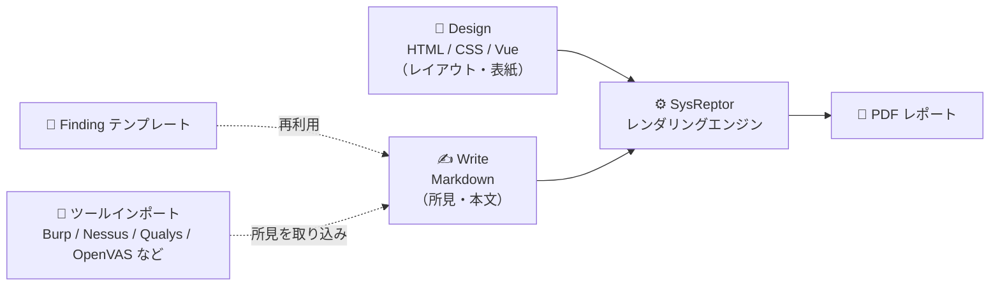
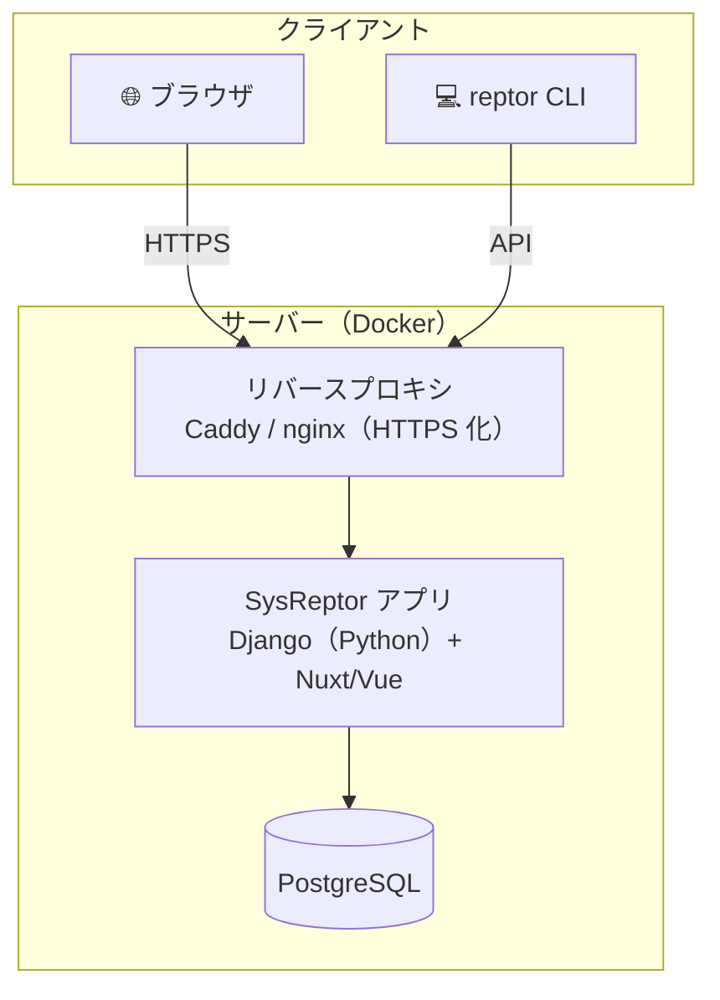

---

この記事は[Zenn](https://zenn.dev/long910/articles/2026-10-27-sysreptor)でも公開しています。


## はじめに

ペネトレーションテストや脆弱性診断の現場で、意外と時間を奪われるのが **レポート作成** です。Word のテンプレートに所見を貼り付け、スクリーンショットの位置を直し、深刻度の色を手で塗り……という作業に心当たりがある人は多いと思います。

この「レポート作成」に特化したプラットフォームが **SysReptor（シスレプター）** です。オーストリアの [Syslifters](https://www.syslifters.com/) が開発しており、レポートのデザインを HTML/CSS で定義し、本文を Markdown で書き、ワンクリックで PDF に出力する、という思想のツールです。

本記事では、公式ドキュメントと GitHub リポジトリで確認できる範囲の情報をもとに、SysReptor の概要・機能・エディションの違い・セルフホストの始め方を整理します。

:::message
本記事は 2026 年 10 月時点で公開されている公式情報（[GitHub](https://github.com/Syslifters/sysreptor)・[公式ドキュメント](https://docs.sysreptor.com/)）をもとにまとめています。価格や機能は変更される可能性があるため、導入前に必ず最新の公式情報を確認してください。
:::

---

## SysReptor とは

**SysReptor** は、オフェンシブセキュリティの専門家（ペネトレーションテスター、レッドチーム、セキュリティ監査担当者など）に向けた、カスタマイズ可能なレポーティングプラットフォームです。公式サイトは "Pentest Reporting Easy as Pie"（ペンテストレポートをパイのように簡単に）というキャッチコピーを掲げています。

| 項目 | 内容 |
|------|------|
| 開発元 | Syslifters GmbH（オーストリア） |
| 位置づけ | ペネトレーションテスト／セキュリティ診断のレポーティング基盤 |
| 提供形態 | セルフホスト（Docker）または クラウド |
| ライセンス | ソースアベイラブルの独自ライセンス（SysReptor Community License） |
| 技術スタック | Django（Python）+ Vue/Nuxt + PostgreSQL、Docker で配布 |
| デモ | [sysreptor.com/demo](https://sysreptor.com/demo)（Playground） |

公式デモ（[demo.sysre.pt](https://sysreptor.com/demo)）にアクセスすると、サンプルプロジェクト（Calzone / Margherita / OffSec OSCP+ Exam Report）が用意されたダッシュボードから、実際の操作感を試せます。

### 基本的なワークフロー

SysReptor の思想は、公式の 3 ステップに集約されています。

1. **Design your report in HTML** — レポートの見た目（レイアウト・ヘッダー・フッター・表紙など）を HTML/CSS、必要に応じて Vue のテンプレート構文で定義する
2. **Write it in Markdown** — 所見（Finding）や本文を Markdown で書く
3. **Render to PDF** — デザインと本文を合成して PDF をレンダリングする

「見た目の定義」と「内容の記述」を分離しているのがポイントです。デザインを一度作り込めば、以降のレポートは Markdown を書くだけで統一されたフォーマットの PDF が得られます。



「Publish」画面ではワンクリックで PDF をレンダリングし、プレビューを確認してからダウンロードできます。デザインに組み込まれた表紙・ヘッダー・透かし（下の例では DRAFT）などがそのまま反映されます。次の画像は、公式デモのサンプルプロジェクトを PDF レンダリングした表紙ページです。


*SysReptor が出力した PDF レポートの表紙例（画像は SysReptor 公式デモ demo.sysre.pt の出力より）*

:::message alert
SysReptor は「レポート作成」のためのツールであり、スキャンや攻撃そのものを行うツールではありません。診断行為は、自分が管理・所有するシステム、または書面による明示的な許可を得た対象に対してのみ実施してください。
:::

---

## 主な機能

公式ドキュメントで挙げられている主な機能は次のとおりです。

- **カスタムデザイン** — HTML/CSS（＋Vue テンプレート）でレポートの見た目を自由に設計できる
- **Markdown での執筆** — 所見・本文を Markdown で記述。表・コードブロック・画像の埋め込みに対応
- **PDF レンダリング** — デザインと本文を組み合わせてプロ品質の PDF を生成
- **Finding テンプレート** — よく使う所見（脆弱性）を再利用可能なテンプレートとして管理
- **ノート機能** — 診断中のメモや証跡を残すノートテイキング
- **アーカイブ** — プロジェクトの暗号化アーカイブ
- **コラボレーション** — コメント・レビューワークフロー（※履歴管理などは後述のエディション差あり）
- **CLI / API による自動化** — Python 製の CLI ツール `reptor` と API で、他ツールの出力を取り込んだり処理を自動化したりできる

編集画面では、左にレポートのセクション（Executive Summary / Scope / Customer など）と Finding（所見）の一覧、右に編集フォームが並びます。各 Finding は **CVSS ベクタでスコアリング**でき、本文は Markdown で記述します。エディタは「Write（記述）／Split（左右分割）／Preview（プレビュー）」を切り替えられ、Split 表示では左に Markdown、右にレンダリング結果が並びます。

こうして書いた所見が、PDF では次のように整形されます。CVSS スコア（10.0 Critical）や参照 URL が表組みになり、Markdown で書いた Overview / Details が本文として組版されています。


*Markdown で書いた所見が CVSS スコア付きで整形された PDF 出力（画像は SysReptor 公式デモの出力より）*

### コンポーネント構成（セルフホスト時）

セルフホストは Docker で複数コンテナが起動する構成です。ユーザーはブラウザから Web UI にアクセスし、必要に応じて `reptor` CLI で API を叩きます。



### 他ツールからのインポート

`reptor` CLI を使うと、スキャンツールの出力を SysReptor に取り込めます。公式ドキュメントで言及されているものとして、**Burp Suite・Nessus・Qualys・OpenVAS** などがあります。所見を手で転記する手間を減らせるのが狙いです。

### 認定試験向けのテンプレート

GitHub リポジトリには、OffSec や Hack The Box の認定試験レポート向けのテンプレート／ユースケースが紹介されています（OSCP・OSED・OSEP・OSWA・OSWP・CPTS など）。試験のレポート提出で使う用途も想定されています。

---

## エディションの違い（Community と Professional）

SysReptor には無償の **Community** と有償の **Professional（PRO）** があります。ここは誤解しやすいので、公式の記述に沿って整理します。

### Community（無償・セルフホスト）

Community でも、レポーティングの中核機能は一通り使えます。

- プロジェクト・デザイン・テンプレート・ノート・アーカイブ・ツールインポートは **数の制限なし**
- 無償でセルフホスト可能
- **ユーザー数には上限あり**（執筆時点の記載は 3 名。最新の上限は[公式のプライシング](https://sysreptor.com/pricing)で確認してください）

### Professional（有償）が追加する機能

Professional は Community に対して、主に次の機能を追加します。

| 機能 | Community | Professional |
|------|:---------:|:------------:|
| レポート作成・PDF 出力 | ✅ | ✅ |
| Finding テンプレート / ノート / アーカイブ | ✅ | ✅ |
| ツールインポート | ✅ | ✅ |
| ユーザー数 | 上限あり | 拡張可能 |
| スペルチェック（LanguageTool） | ❌ | ✅ |
| バージョン履歴（プロジェクト／所見／ノート／デザイン） | ❌ | ✅ |
| きめ細かいユーザー権限管理 | ❌ | ✅ |
| SSO（Keycloak / Entra ID / Google / ADFS） | ❌ | ✅ |

Professional は有償で、セルフホスト用ライセンスとマネージドなクラウド（Cloud Pro）の両方が提供されています。価格やユーザー数の上限は変更されることがあるため、[公式のプライシング](https://sysreptor.com/pricing)を確認してください。

:::message
Hack The Box / OffSec の学生向けに、**SysReptor Labs** という形で Pro 相当の機能を無償提供するプログラムもあります。利用条件は公式の案内を確認してください。
:::

### ライセンスについての注意

SysReptor は「オープンソース」と紹介されることが多いですが、厳密には **ソースコードが公開されている独自ライセンス（source-available）** です。ソースを読んで自社内で利用することは可能ですが、再配布・派生物の作成などには制限があります。この点は OSI 準拠のオープンソースライセンスとは異なるため、業務での利用前にライセンス本文を確認することをおすすめします。

なお公式は「商用利用そのものを妨げる制限（ウォーターマークやカスタマイズ不可など）は設けない」という方針を明記しています。

---

## セルフホストで始める

ここでは、公式が案内しているセルフホスト手順を紹介します。

### 動作要件

- **OS**: Ubuntu（公式にサポートされる環境。他の UNIX 系は手動インストールで動く場合あり）
- **メモリ**: 8GB RAM
- **Docker**: 最新の Docker（`docker compose` プラグイン込み）
- **クライアント**: サーバーにネットワーク接続できるモダンブラウザ（Chrome / Edge / Firefox / Safari）

### インストール

公式が提供するインストールスクリプトを実行します。

```bash
bash <(curl -s https://docs.sysreptor.com/install.sh)
```

:::message alert
`curl` で取得したスクリプトを `bash` に直接パイプして実行する形式です。中身を把握したうえで、信頼できるネットワーク・環境で実行してください。不安な場合は一度ファイルに保存して内容を確認してから実行するとよいでしょう。
:::

スクリプトはおおむね次のことを行います。

1. `sysreptor` ディレクトリを作成し、ソースと設定一式を配置
2. 必要な前提パッケージ（`sed`・`curl`・`openssl`・`uuid-runtime`・`coreutils` など）と Docker を準備
3. Docker のボリュームとシークレットを作成
4. Docker Hub からイメージを取得
5. コンテナを起動

### アクセス

インストールが完了すると、次の URL でアクセスできます。

```
http://127.0.0.1:8000/
```

設定を変更したい場合は `sysreptor/deploy/app.env` を編集します。

:::message alert
`127.0.0.1:8000` は HTTP かつローカルアクセス前提です。外部に公開する場合は、公式が推奨する **Caddy**（または nginx / Apache）などのリバースプロキシを前段に置き、HTTPS を有効にしてください。診断レポートは機微情報の塊なので、ここは手を抜かないことが重要です。
:::

---

## どんな人に向いているか

- **レポート作成に毎回同じ体裁を手作業で整えている人** — デザインとテンプレートを作り込めば、以降は Markdown に集中できる
- **少人数のチーム／個人** — Community なら無償で使える（ユーザー数の上限は公式で確認）
- **認定試験のレポートを書く学習者** — 試験向けテンプレートや Labs プログラムがある
- **Git ベースで管理したい開発者寄りの診断者** — HTML/CSS/Markdown という「テキスト」でレポートを扱えるため、バージョン管理や自動化と相性がよい

逆に、上限を超える規模のチームで権限管理・SSO・バージョン履歴・スペルチェックが必要になると Professional が視野に入ります。まずは Community やクラウドの [Playground](https://sysreptor.com/demo) で書き味を確かめてから判断するのがよいでしょう。

---

## まとめ

- SysReptor は、ペンテスト／セキュリティ診断の **レポート作成に特化** したプラットフォーム
- **HTML/CSS でデザイン → Markdown で執筆 → PDF 出力** というワークフローで、見た目と内容を分離できる
- **Community は無償・ユーザー数に上限あり**。中核のレポーティング機能は一通り揃う
- **Professional** はスペルチェック・バージョン履歴・権限管理・SSO などを追加
- セルフホストは **Ubuntu + 8GB RAM + Docker** が前提で、インストールスクリプト 1 行から始められる
- ライセンスは厳密には source-available の独自ライセンスなので、業務利用前に条文の確認を

レポート作成に消耗している診断者にとって、試してみる価値のあるツールです。

---

## 参考リンク

- [SysReptor 公式ドキュメント](https://docs.sysreptor.com/)
- [Syslifters/sysreptor（GitHub）](https://github.com/Syslifters/sysreptor)
- [インストール手順（公式ドキュメント）](https://docs.sysreptor.com/setup/installation)
- [SysReptor FAQ](https://docs.sysreptor.com/faq/application)
- [SysReptor: Open-source penetration testing reporting platform（Help Net Security）](https://www.helpnetsecurity.com/2025/02/12/sysreptor-open-source-penetration-testing-reporting-platform/)
